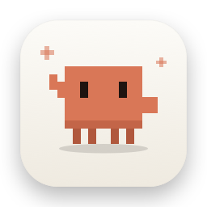
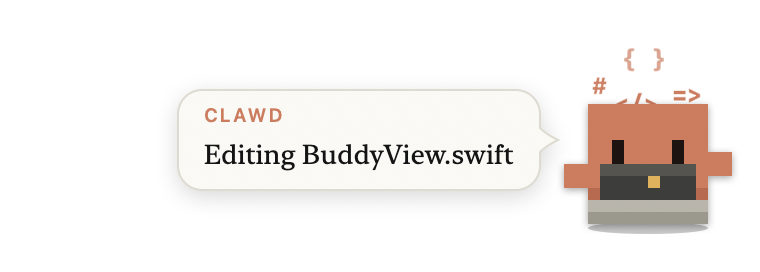
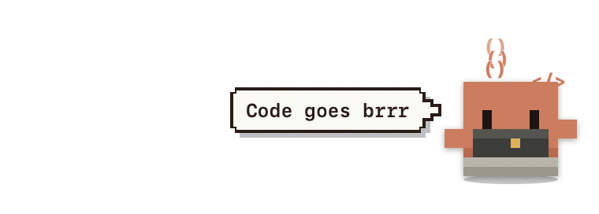
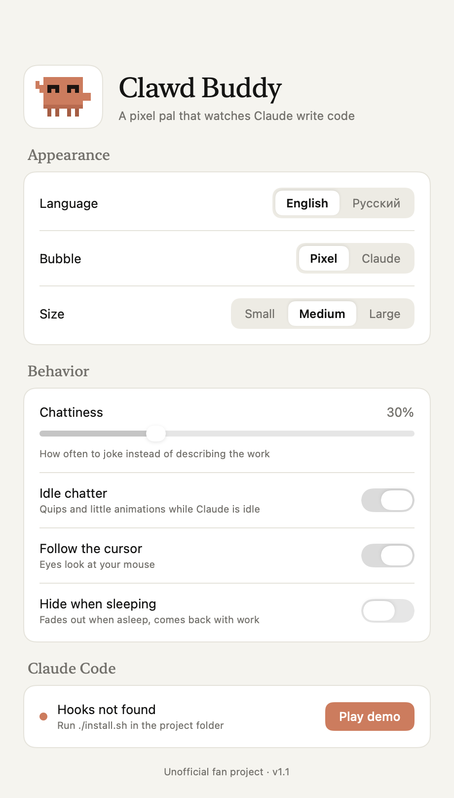

<p align="center"></p>

<h1 align="center">Clawd Buddy</h1>

<p align="center">A tiny pixel crab that lives in the corner of your Mac screen and reacts to what Claude Code is doing.</p>

<p align="center">
  
  
</p>

> Unofficial fan project. Not affiliated with Anthropic.

## What it does

| Claude Code | Clawd |
|---|---|
| You send a prompt | hops, thinks with `?` bubbles |
| Edit / Write | types on a little laptop, `{ } ; </>` fly out |
| Read | reads a document |
| Grep / Glob / Web | scurries around, looking left and right |
| Bash | runs in place; tests, git commit/push, installs and builds get their own lines |
| Tool fails | shakes it off: "Oops… let me fix that" |
| Permission / question / waiting | waves at you until you answer |
| Finished | jumps, confetti |
| 5, 10, 20… edits in one turn | "On a roll! 🔥" |
| An hour of non-stop work | reminds you to take a break |
| Nothing for 2 min | falls asleep and sometimes talks in its sleep |

While idle it looks around, stretches, dances, waves, yawns and wiggles. Its eyes follow your cursor, it smiles when you hover over it, and it flails its legs when you pick it up.

Lines are a mix of what's actually happening and 150+ phrases per language, time-of-day greetings included. English by default, Russian available.

## Install

Requires macOS 13+ and Xcode Command Line Tools (`xcode-select --install`).

```bash
git clone https://github.com/pe4enku0/clawd-buddy.git
cd clawd-buddy
./install.sh
```

This builds the app, copies it to `~/Applications/ClawdBuddy.app`, and adds async hooks to `~/.claude/settings.json`. Your other settings are kept, and the original file is backed up once as `settings.json.bak-clawdbuddy`. If the app isn't running, the next Claude Code event starts it.

## Use

- **Drag** the crab anywhere. The position is remembered.
- **Click** the crab to poke it. Click the bubble to dismiss it.
- **Right-click** the crab, or use the crab in the menu bar, for **Settings…** (⌘,), language, demo, hide/show, reset position, quit.

<p align="center"></p>

Settings:
- **Language**: English or Russian.
- **Bubble**: Pixel or Claude style. The Claude style follows light/dark mode.
- **Size**: Small, Medium or Large.
- **Chattiness**: how often it jokes instead of describing the work.
- **Idle chatter**, **follow the cursor**, **hide when sleeping**.
- **Hook status**, plus a **Play demo** button that runs through every animation.

The buddy window is click-through except for the crab and its bubble, never takes focus, and shows on every Space.

## Uninstall

```bash
./uninstall.sh
```

Removes the app and only the Clawd Buddy hooks.

## How it works

One Swift binary, three modes:

- `ClawdBuddy hook`: Claude Code runs this. It reads the hook JSON from stdin, reduces it to `{event, tool, detail}`, and posts it as a macOS distributed notification.
- `ClawdBuddy make-icon <dir>`: renders the app icon from the same sprite code (used by `build.sh`).
- `ClawdBuddy`: the buddy itself.

| File | |
|---|---|
| `Sources/BuddyView.swift` | sprite, poses, props, particles, bubbles, mouse |
| `Sources/Brain.swift` | hook event → mood, line, idle routines |
| `Sources/Strings.swift` | all EN/RU text |
| `Sources/SettingsWindow.swift` | SwiftUI settings in a Claude-like style |
| `Sources/Prefs.swift` | persisted settings |
| `Sources/HookBridge.swift` | the `hook` mode |
| `Sources/Icon.swift` | app icon renderer |
